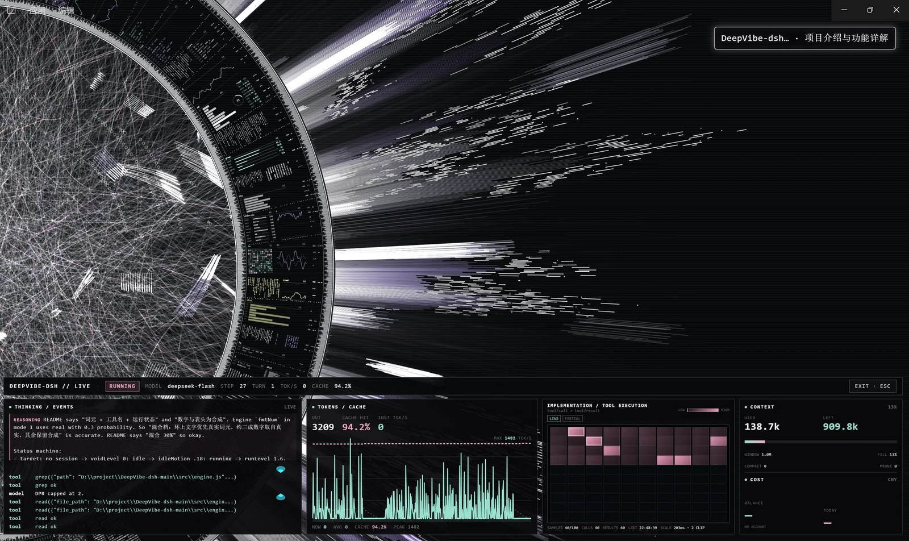
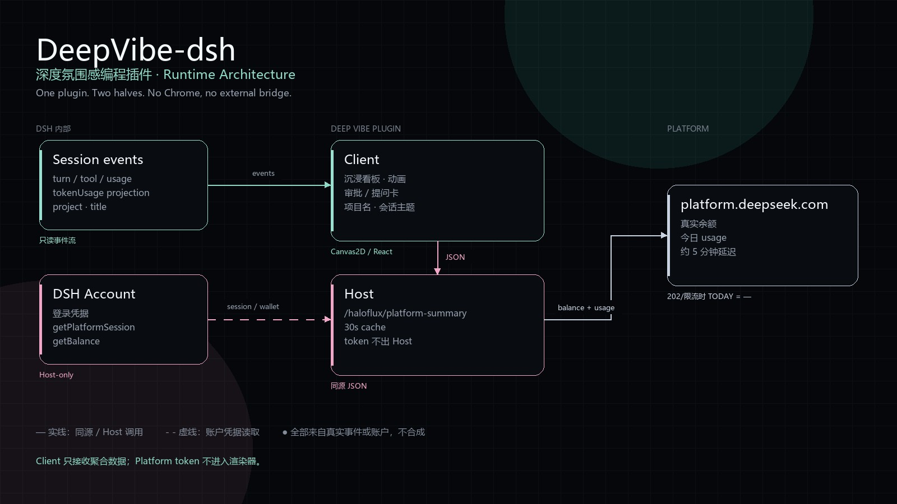

# DeepVibe-dsh — 深度氛围感编程插件

> 让 AI 写代码的时候，屏幕也有点“在场感”。



*实机截图：模型运行中的沉浸看板。顶部是项目名与会话主题，底部四块看板展示推理事件、Token/Cache、10×10 工具热力图、上下文与 Platform 余额/今日消费。*

DeepVibe-dsh 不是一个会抢戏的壁纸，而是一层会读会话的**深度氛围感编程插件**。它把 HALOFLUX 的 Canvas 光场接进 DeepSeek Harness：模型开工，光环醒来；词元流出，光点聚散；工具执行，热力图逐格亮起；任务收尾，整个画面慢慢安静。

**沉浸模式**下，它会升起四块真实数据卡：模型状态、上下文与花费、10×10 工具执行热力图、余额与今日消费。模型要审批或提问时，决策卡直接出现在右侧，选项、补充输入、拒绝、提交都在原地完成。

**它最在意的是“真”**：词元、工具耗时、上下文、缓存命中、平台账单，全部来自当前 DSH 会话与账户；没有数据就留白，不编造。没有 Chrome，没有外部桥接，安装后随 DSH 一起启动。

### 为什么它有点不一样

- **会呼吸，但不吵**：运行、空闲、审批、提问各有节奏；该亮的时候亮，该停的时候停。
- **数据不是装饰**：每一次亮起、每一格热力图、每一笔花费，都能在会话或平台账单里找到出处。
- **一个插件，不是一堆脚本**：Host + Client 打包在同一个插件里，装好即用，不额外拉起浏览器或本地服务。

## 运行实拍

上面这张就是实际运行画面：沉浸光环、右上角会话主题，以及底部四块实时看板同时工作。

> 本包是自包含的：运行、构建、测试都只依赖包内文件与 DSH 自带的宿主接口，
> 不依赖工作区里的其它目录。

---

## 它是怎么工作的



- **Client**：消费 DSH 会话事件，负责光环、沉浸看板、审批/提问卡与会话主题。
- **Host**：用 DSH 账户的 Host-only 凭据读取平台余额与今日 usage，只把聚合 JSON 交给 Client。
- **没有外部浏览器**：不需要 Chrome、CDP、Playwright 或本地 47821 桥；平台 token 不进入渲染器。

## 一、功能

| 能力 | 说明 |
|---|---|
| 全帧背景 | 挂载在 `shell.overlay`：透明底 + 加色发光，点击穿透，不遮挡聊天界面 |
| 会话驱动 | 词元、工具调用、`turn/step`、tok/s、上下文占用全部来自真实会话事件流 |
| 三档数据抓取 | 纯动画 / 混合 30% / 完全抓取，见下文 |
| 设置页面 | **设置 → DeepVibe-dsh**：档位、预设、导入导出、全部 82 个参数 |
| 沉浸看板 | 运行时升起四块真实数据卡（模型、上下文、实现热力图、余额/今日消费） |
| 沉浸审批 | 右侧审批卡直接「拒绝 / 允许一次」，等待审批时运动静止、亮度保持 |
| 沉浸提问 | 问题、选项、多选、补充输入、拒绝/提交；提交驱动原生 waterfall |
| 缓存命中 | 使用 DSH `tokenUsage` 投影，整个会话口径，一位小数 |
| 会话主题 | 沉浸右上角显示「项目名 · 会话主题」，白框发光 |
| 平台账单 | Host 用 DSH 账户凭据读取 Platform 真实余额与今日实际消费；30 秒轮询，无 Chrome 依赖；平台不可用时 TODAY 显示 —，不用估算冒充 |
| HUD | `H` 键：KPI 条、事件流、工具调度、运镜按钮（默认关闭） |
| 三段状态机 | 运行态 / 静默态 / 无会话 各有目标强度，起势与收势独立时长、可调曲线 |
| 切会话转一圈 | 圆盘平滑转满 360°，外圈光束按层视差跟随 |
| 切换动效（5 个开关） | 外圈跟随 / 内容逐块揭示 / 亮度脉冲 / 色相扫过 / 镜头轻推，各自独立可关 |

## 二、安装

需要已安装 DeepSeek Harness（桌面版或 `dsh web`）。

从 npm 安装：

```text
dsh plugin --profile web add deepvibe-dsh
```

npm 包地址：https://www.npmjs.com/package/deepvibe-dsh

也可以从本地目录安装：

```text
plugin_manager install_bundle  target=<本包目录的绝对路径>
```

也可以分发打好的 tgz。`install_bundle` 需要**解压后的包目录**：

```text
tar -xzf DeepVibe-dsh-0.5.18.tgz
plugin_manager install_bundle  target=<解压出的 package 目录绝对路径>
```

tgz 内包含 Host、Client、`src/`、`tools/`、构建脚本与文档，可独立迁移。

安装后刷新页面，侧栏底部 **设置 → DeepVibe-dsh** 出现即成功。

- 包名 `deepvibe-dsh`，bundle 行 id `haloflux`，同时注册 `shell.overlay` 与 `settings.section`。
- 卸载：`plugin_manager remove_bundle target=deepvibe-dsh`。

### 在 DSH Discover / 插件市场找到

DSH 官方**不内置任何索引源**，Discover 是一个可添加索引 URL 的自定义插件市场。  
本仓库自带一个可直接添加的市场索引：

```text
https://raw.githubusercontent.com/HSYrc/DeepVibe-dsh/main/market/index.json
```

在 DSH 中：

1. 打开 **插件 → 实验性插件 → 更多**，启用 **自定义插件市场**
2. 进入 **发现 → 添加索引源**
3. 填入上面的 URL
4. 搜索 `DeepVibe-dsh`，确认来源后安装

也可以直接从 GitHub 安装：

```text
dsh plugin --profile web add https://github.com/HSYrc/DeepVibe-dsh.git
```

npm 安装：

```text
dsh plugin --profile web add deepvibe-dsh
```

社区市场 DSH Plugin Hub 的收录方式是：GitHub 公开仓库 + `dsh-plugin` topic + README 安装命令，然后到 [dsh-plugin.org 提交页](https://dsh-plugin.org/zh/submit) 提交。它不是 DSH 官方内置市场，但可被该社区市场的用户搜到。

如果要进入 **DeepSeek 官方内置目录**，目前没有公开的自助上架接口，需要由 DeepSeek Harness 官方收录；可以到 [DeepSeek Harness 仓库](https://github.com/deepseek-ai/deepseek-harness) 提 issue/反馈询问收录流程。

## 三、数据抓取档位

设置页顶部的三档开关（参数 `dataMode`）：

| 档 | 名称 | 光环上的文字与数字 | 会话读取 |
|---|---|---|---|
| 0 | 纯动画 | 全部来自原作示例词表与随机数 | 不抓词元（`pullTokens` 跳过）；亮度仍随运行/静默变化 |
| 1 | 混合 30%（默认） | 有词元时来自真实回答，数字与表头为合成 | 词元 + 工具名 + 运行状态 |
| 2 | 完全抓取 | 只显示真实数据：词元、工具名、`STEP n` / `TURN n`、tok/s、上下文；没有就留空 | 全部 |

档位只约束**画布上的文字与数字**；`H` 打开的 HUD 始终是真实会话监视器。

## 四、使用

快捷键（焦点不在输入框内时）：

| 键 | 作用 |
|---|---|
| `C` | 打开/关闭快速调参浮层 |
| `H` | 打开/关闭 HUD |
| `Esc` | 关闭浮层 |

设置页与浮层、画布共用同一份参数（`src/state.js`），任一处改动其余立刻跟随；
「保存为默认」写入 `localStorage`，跨重启保留。

### 切换动效

切换会话时依次发生（都可单独关闭）：

1. `revolveOnSwitch`：圆盘转满一圈（`revolveMs`）；
2. `revolveOuter`：外围光束按层跟随，远端慢、近端快，转起来有纵深；
3. `switchReveal`：转动过程中圆环面板逐块失效重建，旧会话的文字被新会话替换；
4. `switchFlash`：亮度在转圈中点轻微上冲后回落；
5. `switchHue`：可选的色相扫过（默认 0，不开就不换色）；
6. `switchCam`：镜头在 1 → 0.972 → 1 之间轻推一次。

2–6 由 `engine.switchFx()` 驱动，与是否转圈解耦：关掉转圈，其余效果仍然生效。

运行中的会话切到**空闲**会话时，收光会与转圈重叠（约 260ms 后开始衰减），不会亮着转完再暗；
若觉得转圈中点的亮度脉冲抢戏，把 `switchFlash` 调低或设 0。

## 五、参数

共 **82 项**，分 6 组：原作 **56 项**（`全局` 5 / `圆环` 7 / `圈内` 18 / `环外` 17 / `空间层次` 9），
本项目新增 **23 项**（`插件` 组）：

| 参数 | 默认 | 作用 |
|---|---|---|
| `opacity` | 0.45 | 整层不透明度 |
| `blend` | 0 | 混合模式 0=screen 1=lighten 2=normal |
| `activityGain` | 1 | 活跃度对生成速率的增益 |
| `centerX` / `centerY` | -0.15 / 0 | 构图中心偏移 |
| `scale` | 0.6 | 整体缩放 |
| `hudOn` | 0 | HUD 开关 |
| `feedOn` | 1 | 事件流开关 |
| `dataMode` | 1 | 数据抓取档位 0/1/2 |
| `backdrop` | 0 | 深色底比例；0 = 纯透明发光 |
| `runLevel` | 1 | 运行态强度 |
| `idleMotion` | 0.18 | 静默态强度 |
| `voidLevel` | 0 | 无会话强度；0 = 整帧透明 |
| `attackMs` | 800 | 起势时长 |
| `releaseMs` | 2600 | 收势时长 |
| `easeCurve` | 1 | 过渡曲线 0 线性 / 1 平滑 / 2 双 S |
| `revolveOnSwitch` | 1 | 切换会话是否转满一圈 |
| `revolveMs` | 1500 | 整圈用时 |
| `camera`（原作） | 0 | 自动运镜开关；0 = 固定机位 |
| `revolveOuter` | 1 | 切换时外圈光束跟随转圈（远层 0.35 / 主层 1.0 / 近层 1.15 的视差） |
| `switchReveal` | 1 | 切换时圆环面板逐块重建，内容随转动换成新会话 |
| `switchFlash` | 0.6 | 切换窗口内的亮度脉冲强度；0 = 关 |
| `switchHue` | 0 | 切换窗口内的色相扫过强度；0 = 关（默认不换色） |
| `switchCam` | 1 | 切换时镜头轻微推拉（约 2.8% 缩放，不改相机状态） |

## 六、数据来源（只读）

全部来自 Client 已有的会话服务，不新增 Host 事件、不写会话日志：

- `ctx.sessions.binding(sessionId)` → `eventSource`
  - `transient` 条目 = 流式词元（`assistant/live-chunk` 的 `text-delta`）
  - 持久事件 = `turn/step`、`user/message`、`assistant/message`（含 `usage`）、`tool/call`、`tool/result`
- `useSessions` 找当前打开的会话，`useSessionStatus` 给「运行中/空闲」
- tok/s、上下文占用、工具状态由 `src/live.js` 派生
- Host 路由 `GET /haloflux/platform-summary` 使用 `deepseekAccount.getPlatformSession()` 的 Host-only 凭据读取 Platform 余额和今日实际消费；token 不下发到 Client

任何宿主调用都包在 `try/catch` 里；绑定消失、切会话、销毁都会释放订阅与定时器。

## 七、源码结构与构建

```text
deepvibe-dsh/
├─ package.json          # bundle 清单 + dsh.client
├─ cordis.patch.yml      # 插入 haloflux 行
├─ index.js              # Host 半边：平台余额/今日消费的只读同源路由
├─ client.js             # ★ 构建产物（浏览器加载的唯一文件，勿手改）
├─ build.mjs             # 拼接 src/*.js → client.js
├─ src/
│  ├─ engine.js          # Canvas 引擎（渲染、状态机、数据档位）
│  ├─ state.js           # 参数 store（三个 React 根共用）
│  ├─ live.js            # 会话实时数据适配
│  ├─ hud.js             # HUD + 参数控件
│  ├─ settings.js        # 设置 → DeepVibe-dsh 页面
│  └─ mount.js           # 槽注册、组件装配、快捷键
├─ locale/{en,zh}.json   # 插件管理器展示文案
├─ icon.svg              # 图标
├─ tools/                # 无头自测脚本
├─ LICENSE               # PolyForm Noncommercial 1.0.0
└─ NOTICE                # 署名与再分发要求
```

构建：

```bash
node build.mjs && node --check client.js
```

改完 `src/` 后需要重新 `install_bundle`（或重启 Host）并刷新页面。

## 八、测试

四个脚本都不需要浏览器，也不需要包外文件：

```bash
node tools/engine-smoke.cjs     # 无头假 DOM + 记录型 2D context（含三档数据断言）
node tools/live-selftest.mjs    # 假 binding/eventSource：词元队列、tok/s、订阅生命周期
node tools/client-smoke.cjs     # 假 module loader：装配、双槽注册、参数 store
node tools/session-switch.cjs   # 切会话回归：运行态不被清、内容换到新会话、旧订阅释放
```

`tools/_engine-probe.mjs` 是参数表的静态检查（项数、分组、重复键、预设）。

## 九、兼容性

- 实测于 DeepSeek Harness **0.2.1-rc.2**（Windows 桌面版）。
- 依赖宿主内部约定：`shell.overlay` / `settings.section` 槽位、槽位标准 props
  `useSessions` / `useSessionStatus`、`sessions.binding()` 的 `eventSource`。
  这些接口跨大版本可能变化；升级 DSH 后若出现白屏，先在这里排查。

## 十、许可与致谢

- 原作 **HALOFLUX**：Copyright (c) 2026 Ryder191（RYDER CODE / Ms MAIKEBAIs CAT），
  <https://github.com/Ryder191/haloflux>，PolyForm Noncommercial License 1.0.0。
- 本移植：同样**仅限非商业使用**，可在保留 `LICENSE` 与 `NOTICE` 的前提下自由分发与修改。
- 再分发、二次修改请保留 `NOTICE` 中的 Required Notice 行。
